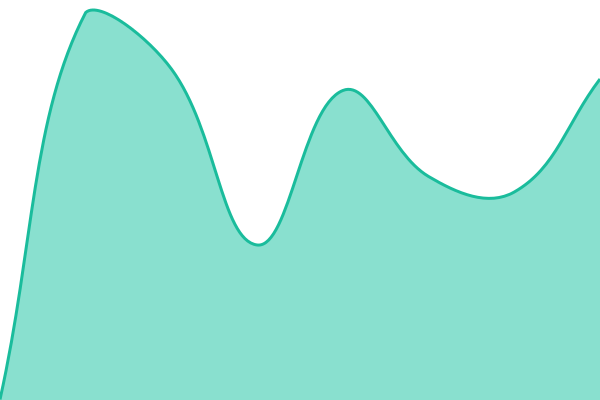
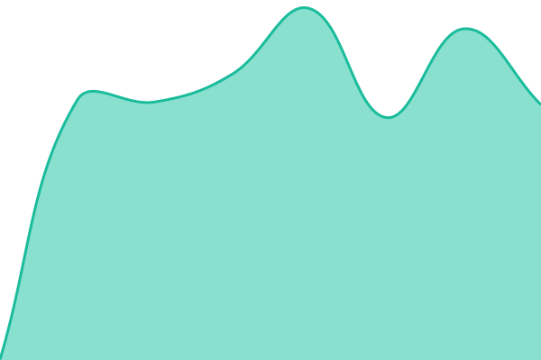
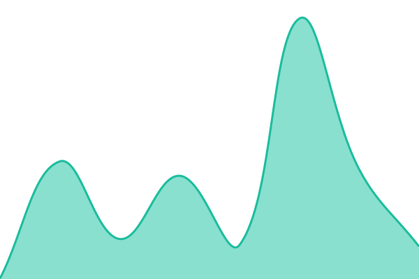
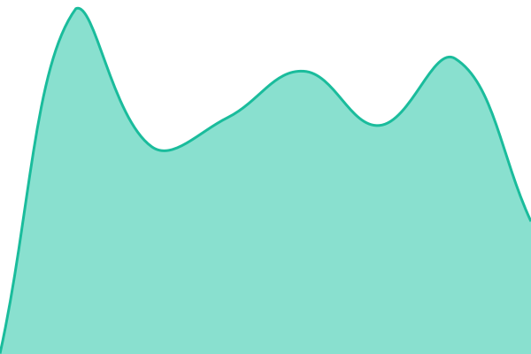

# [📈 Live Status](https://JazzyJayBEE.github.io/icss-status): <!--live status--> **🟩 All systems operational**

This repository contains the open-source uptime monitor and status page for [JazzyJayBEE](https://JazzyJayBEE.github.io/icss-status), powered by [Upptime](https://github.com/upptime/upptime).

With [Upptime](https://upptime.js.org), you can get your own unlimited and free uptime monitor and status page, powered entirely by a GitHub repository. We use [Issues](https://github.com/JazzyJayBEE/icss-status/issues) as incident reports, [Actions](https://github.com/JazzyJayBEE/icss-status/actions) as uptime monitors, and [Pages](https://JazzyJayBEE.github.io/icss-status) for the status page.

<!--start: status pages-->
<!-- This summary is generated by Upptime (https://github.com/upptime/upptime) -->
<!-- Do not edit this manually, your changes will be overwritten -->
<!-- prettier-ignore -->
| URL | Status | History | Response Time | Uptime |
| --- | ------ | ------- | ------------- | ------ |
|  [ICSS Storefront](https://icssinc.com/) | 🟩 Up | [icss-storefront.yml](https://github.com/JazzyJayBEE/icss-status/commits/HEAD/history/icss-storefront.yml) | 

 480ms
     
 | 

<a href="https://JazzyJayBEE.github.io/icss-status/history/icss-storefront">100.00%</a>
    

|  Hosted site 01 | 🟩 Up | [hosted-site-01.yml](https://github.com/JazzyJayBEE/icss-status/commits/HEAD/history/hosted-site-01.yml) | 

 758ms
     
 | 

<a href="https://JazzyJayBEE.github.io/icss-status/history/hosted-site-01">100.00%</a>
    

|  Hosted site 02 | 🟩 Up | [hosted-site-02.yml](https://github.com/JazzyJayBEE/icss-status/commits/HEAD/history/hosted-site-02.yml) | 

 1644ms
     
 | 

<a href="https://JazzyJayBEE.github.io/icss-status/history/hosted-site-02">100.00%</a>
    

|  Hosted site 03 | 🟩 Up | [hosted-site-03.yml](https://github.com/JazzyJayBEE/icss-status/commits/HEAD/history/hosted-site-03.yml) | 

 688ms
     
 | 

<a href="https://JazzyJayBEE.github.io/icss-status/history/hosted-site-03">100.00%</a>
    

|  Hosted site 04 | 🟩 Up | [hosted-site-04.yml](https://github.com/JazzyJayBEE/icss-status/commits/HEAD/history/hosted-site-04.yml) | 

 240ms
     
 | 

<a href="https://JazzyJayBEE.github.io/icss-status/history/hosted-site-04">100.00%</a>
    

|  Hosted site 05 | 🟩 Up | [hosted-site-05.yml](https://github.com/JazzyJayBEE/icss-status/commits/HEAD/history/hosted-site-05.yml) | 

 201ms
     
 | 

<a href="https://JazzyJayBEE.github.io/icss-status/history/hosted-site-05">100.00%</a>
    

|  Hosted site 06 | 🟩 Up | [hosted-site-06.yml](https://github.com/JazzyJayBEE/icss-status/commits/HEAD/history/hosted-site-06.yml) | 

 383ms
     
 | 

<a href="https://JazzyJayBEE.github.io/icss-status/history/hosted-site-06">100.00%</a>
    

|  Hosted site 07 | 🟩 Up | [hosted-site-07.yml](https://github.com/JazzyJayBEE/icss-status/commits/HEAD/history/hosted-site-07.yml) | 

 631ms
     
 | 

<a href="https://JazzyJayBEE.github.io/icss-status/history/hosted-site-07">100.00%</a>
    

|  Hosted site 08 | 🟩 Up | [hosted-site-08.yml](https://github.com/JazzyJayBEE/icss-status/commits/HEAD/history/hosted-site-08.yml) | 

 870ms
     
 | 

<a href="https://JazzyJayBEE.github.io/icss-status/history/hosted-site-08">100.00%</a>
    

<!--end: status pages-->

[**Visit our status website →**](https://JazzyJayBEE.github.io/icss-status)

## 📄 License

- Powered by: [Upptime](https://github.com/upptime/upptime)
- Code: [MIT](./LICENSE) © [Anand Chowdhary](https://anandchowdhary.com)
- Data in the `./history` directory: [Open Database License](https://opendatacommons.org/licenses/odbl/1-0/)
